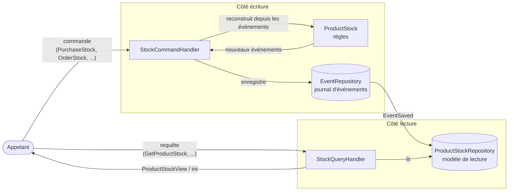

# Service de stock CQRS

[English](README.md)

Un petit service de gestion de stock construit avec **CQRS** (Command Query Responsibility Segregation, séparation des responsabilités entre commandes et requêtes) et un côté écriture en **event sourcing**, sur .NET 11.

Il suit le stock de chaque produit (identifié par un EAN de 8 caractères) : achats, commandes, inventaires, stock actuel, stock à une date passée et variation de stock sur une période.

## Pourquoi cette implémentation

J'ai réalisé ce projet comme exercice technique pour un entretien d'embauche : gérer le stock de produits (achats, commandes, inventaires) et répondre à des questions dessus, y compris à des dates passées. J'ai choisi CQRS avec un côté écriture en event sourcing parce que le problème s'y prête, et parce que cela me permettait de montrer ma façon d'aborder la conception, pas seulement d'obtenir les bons chiffres.

- **Les écritures et les lectures n'ont pas la même forme.** Il n'y a que quelques façons de modifier le stock (achat, commande, inventaire), mais beaucoup de questions différentes à son sujet : stock actuel, stock à une date, variation sur une période, produits en stock. CQRS permet de modéliser chaque côté pour son propre rôle, au lieu d'un seul modèle qui fait des compromis pour les deux.
- **L'historique fait partie du besoin.** « Le stock à une date donnée » et « la variation entre deux dates » nécessitent chaque mouvement, pas seulement la quantité actuelle. Enregistrer chaque changement sous forme d'événement conserve naturellement cet historique, et le modèle de lecture peut en déduire le stock à n'importe quelle date.
- **Les règles sont au même endroit.** La vérification de l'EAN, la règle de date d'inventaire et les lots « tout ou rien » sont appliqués par le côté écriture avant tout enregistrement, et aucune lecture ne peut modifier le stock.
- **C'est facile à tester et à faire évoluer.** Les commandes et les requêtes sont de simples records, donc les tests se lisent comme des scénarios métier. Une nouvelle question, c'est une nouvelle requête (et une nouvelle projection si besoin), sans toucher au côté écriture.
- **Les compromis sont visibles.** Les écritures concurrentes, les lots atomiques et l'écart entre cette version en mémoire et la production sont des sujets dont je voulais pouvoir discuter. La section [Limites](#limites) liste ce que je changerais pour la production.

Pour un problème de cette taille, un modèle unique fonctionnerait aussi. J'ai choisi CQRS délibérément, pour montrer le pattern sur un domaine où il a du sens, et j'ai gardé l'infrastructure en mémoire pour que la conception reste facile à lire.

## L'idée en un paragraphe

Modifier le stock et lire le stock sont pris en charge par deux côtés séparés qui ne partagent aucun état. Le **côté écriture** reçoit les commandes, vérifie les règles métier et enregistre ce qui s'est passé sous forme d'**événements** dans un journal d'événements, qui fait foi. Le **côté lecture** écoute ces événements et tient son propre **modèle de lecture**, organisé pour les questions que posent les requêtes. Les requêtes ne lisent que ce modèle et renvoient des vues en lecture seule. Aucun des deux côtés n'accède à l'autre.



## Organisation des projets

| Projet | Dossier | Contenu |
|---|---|---|
| `Cqrs.implementation.Stock` | `Cqrs.implementation.Stock/` | Le domaine : commandes, requêtes, événements, le modèle d'écriture `ProductStock` et les interfaces des handlers (`ICommandHandler<T>`, `IQueryHandler<TQuery, TResult>`). Aucune dépendance. |
| `Cqrs.implementation.Infrastructure` | `Cqrs.implementation.StockService/` | Les deux handlers, le magasin d'événements, le modèle de lecture et leurs ports (`IEventRepository`, `IProductStockRepository`). |
| `Cqrs.implementation.Stock.Tests` | `Cqrs.implementation.Stock.Tests/` | Tests NUnit qui passent uniquement par les commandes et les requêtes. |

## Côté écriture

Les **commandes** (`Commands.cs`) sont de simples records : elles disent ce que veut l'appelant, pas comment le faire.

| Commande | Effet |
|---|---|
| `PurchaseStock(Ean, Quantity, Label, Date)` | Ajoute `Quantity` au stock. |
| `OrderStock(Ean, Quantity, Label, Date)` | Retire `Quantity` du stock. |
| `RecordStockMovements(Movements)` | Plusieurs achats et commandes, enregistrés **tous ou aucun**. |
| `TakeInventory(Ean, Quantity, Date)` | Fixe le stock à la quantité comptée `Quantity`. |

**`StockCommandHandler`** traite chaque commande de la même façon :

1. Reconstruire le `ProductStock` de chaque produit à partir de ses événements enregistrés.
2. Lui demander d'appliquer le changement. `ProductStock` fait respecter les règles et produit de nouveaux événements.
3. Enregistrer les nouveaux événements en un seul appel à `EventRepository.Save`.

Les **événements** (`Events.cs`) sont les faits enregistrés :

- `StockMoved(Ean, Quantity, Label, Date)` : quantité positive pour un achat, négative pour une commande.
- `InventoryTaken(Ean, Quantity, Date)`.

**`ProductStock`** est le modèle d'écriture d'un produit. Il ne garde que l'état dont ses règles ont besoin (la date du dernier inventaire), pas la quantité : calculer les quantités, c'est le rôle du modèle de lecture.

### Règles métier

| Règle | Erreur |
|---|---|
| Un EAN doit faire exactement 8 caractères. | `ArgumentException` |
| La quantité d'un inventaire ne peut pas être négative. | `ArgumentException` |
| Un mouvement ne peut pas être daté avant ou au moment du dernier inventaire du produit. | `InvalidOperationException` |

Le stock peut devenir négatif : une commande supérieure au stock est acceptée.

### Cohérence

- **Les lots sont atomiques.** Chaque mouvement d'un `RecordStockMovements` est vérifié avant tout enregistrement, donc un seul mouvement refusé n'enregistre rien.
- **Les écritures concurrentes sont détectées** (concurrence optimiste). Chaque `ProductStock` retient le nombre d'événements à partir desquels il a été construit (`Version`). Si une autre commande a enregistré des événements pour le même produit entre-temps, `Save` lève une `InvalidOperationException`, et il faut relancer la commande.
- **Les événements ne sont publiés qu'une fois tous enregistrés**, donc un abonné en échec ne peut pas laisser un lot à moitié enregistré.

## Côté lecture

**`ProductStockRepository`** est le modèle de lecture. Il s'abonne à `EventRepository.EventSaved` et garde sa propre copie des changements de stock de chaque produit, triés par date. Le stock à tout instant vient d'un seul calcul : un inventaire fixe le niveau, un mouvement s'y ajoute.

Les **requêtes** (`Queries.cs`) sont de simples records, traitées par **`StockQueryHandler`** à partir du modèle de lecture uniquement :

| Requête | Renvoie |
|---|---|
| `GetProductStock(Ean)` | Le stock actuel sous forme de `ProductStockView`, ou `null` pour un produit inconnu. |
| `GetProductsInStock()` | Tous les produits dont le stock est supérieur à 0. |
| `CountProductsInStock()` | Le nombre de produits dont le stock est supérieur à 0. |
| `GetStockAtDate(Ean, Date)` | Le stock une fois appliqués tous les changements datés au plus tard à `Date` (0 s'il n'y en a aucun). |
| `GetStockVariation(Ean, From, To)` | Le stock à `To` moins le stock juste avant `From`, donc un mouvement daté exactement à `From` est compté. |

Les requêtes renvoient des records `ProductStockView` ou des nombres, jamais le modèle d'écriture : un lecteur ne peut donc pas modifier le stock sans envoyer de commande.

**Les changements s'appliquent dans l'ordre des dates, pas dans leur ordre d'arrivée.** Par exemple, un achat daté après un inventaire s'ajoute à celui-ci, même s'il a été enregistré avant. Les changements de même date gardent leur ordre d'enregistrement. Utilisez un seul fuseau horaire (de préférence UTC) pour toutes les dates.

## Utilisation

```csharp
var events = new EventRepository();
var readModel = new ProductStockRepository(events); // à créer avant la première commande, voir Limites
var commands = new StockCommandHandler(events);
var queries = new StockQueryHandler(readModel);

commands.Handle(new PurchaseStock("EAN00001", 10, "Achat N°1", DateTime.UtcNow));
commands.Handle(new OrderStock("EAN00001", 3, "Commande N°1", DateTime.UtcNow));

var stock = queries.Handle(new GetProductStock("EAN00001")); // stock.Quantity == 7
```

Dans une application, enregistrez les handlers dans votre conteneur d'injection de dépendances et injectez `ICommandHandler<PurchaseStock>`, `IQueryHandler<GetProductStock, ProductStockView?>`, etc. là où vous en avez besoin.

## Limites

Ce sont des raccourcis volontaires, signalés par des commentaires `shortcut:` dans le code :

- **Tout est en mémoire.** Les événements et le modèle de lecture sont perdus au redémarrage. Remplacez `EventRepository` par un magasin d'événements persistant derrière `IEventRepository`.
- **Le modèle de lecture ne voit que les événements enregistrés après sa création.** Une fois les événements persistés, rejouez-les dans le modèle de lecture au démarrage.
- **Chaque lecture rejoue les changements du produit.** Suffisant pour des historiques courts ; stockez des totaux cumulés si les historiques s'allongent.
- **Le modèle de lecture est mis à jour de façon synchrone**, pendant l'enregistrement. En production, on le met généralement à jour de façon asynchrone, en acceptant que les lectures aient un léger retard sur les écritures (cohérence à terme).
- **Il n'y a ni dispatcher ni bus de messages.** Les appelants obtiennent le handler dont ils ont besoin, par exemple via l'injection de dépendances.

## Compiler et tester

Nécessite le SDK .NET 11.0.100 ou une version 11.0.x plus récente (fixé dans `global.json`).

```sh
dotnet build
dotnet test
```
