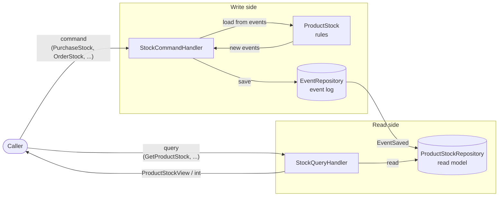

# CQRS stock service

[Français](README.fr.md)

A small stock-management service built with **CQRS** (Command Query Responsibility Segregation) and an **event-sourced** write side, on .NET 11.

It tracks stock per product (identified by an 8-character EAN): purchases, orders, inventories, current stock, stock at a past date, and stock variation over a period.

## Why this implementation

I built this project as a technical exercise for a job interview: manage a product stock (purchases, orders, inventories) and answer questions about it, including at past dates. I chose CQRS with an event-sourced write side because the problem fits it, and because it let me show how I approach design, not only get the right numbers.

- **Writes and reads have different shapes.** There are only a few ways to change stock (purchase, order, inventory), but many different questions about it: current stock, stock at a date, variation over a period, products in stock. CQRS lets each side be modelled for its own job, instead of one model compromising for both.
- **The history is part of the requirement.** "Stock at a given date" and "variation between two dates" need every movement, not just the current quantity. Recording each change as an event keeps that history naturally, and the read model can compute the stock at any date from it.
- **The rules live in one place.** The EAN check, the inventory-date rule and the all-or-nothing batches are enforced by the write side before anything is saved, and no read path can change stock.
- **It is easy to test and to extend.** Commands and queries are plain records, so the tests read like business scenarios. A new question means a new query (and a new projection if needed), without touching the write side.
- **It makes the trade-offs visible.** Concurrent writes, atomic batches and the gap between this in-memory version and production are things I wanted to be able to discuss. The [Limits](#limits) section lists what I would change for production.

For a problem this size, a single model would also work. I picked CQRS deliberately to show the pattern on a domain where it makes sense, and kept the infrastructure in memory so the design stays easy to read.

## The idea in one paragraph

Changing stock and reading stock are handled by two separate sides that share no state. The **write side** receives commands, checks the business rules and records what happened as **events** in an event log, which is the source of truth. The **read side** listens to those events and keeps its own **read model**, shaped for the questions queries ask. Queries only ever read that model and return read-only views. Neither side reaches into the other.



## Project layout

| Project | Folder | Contains |
|---|---|---|
| `Cqrs.implementation.Stock` | `Cqrs.implementation.Stock/` | The domain: commands, queries, events, the `ProductStock` write model and the handler interfaces (`ICommandHandler<T>`, `IQueryHandler<TQuery, TResult>`). No dependencies. |
| `Cqrs.implementation.Infrastructure` | `Cqrs.implementation.StockService/` | The two handlers, the event store, the read model, and their ports (`IEventRepository`, `IProductStockRepository`). |
| `Cqrs.implementation.Stock.Tests` | `Cqrs.implementation.Stock.Tests/` | NUnit tests that drive everything through commands and queries. |

## Write side

**Commands** (`Commands.cs`) are plain records: they say what the caller wants, not how to do it.

| Command | Effect |
|---|---|
| `PurchaseStock(Ean, Quantity, Label, Date)` | Adds `Quantity` to the stock. |
| `OrderStock(Ean, Quantity, Label, Date)` | Removes `Quantity` from the stock. |
| `RecordStockMovements(Movements)` | Several purchases and orders, saved **all or nothing**. |
| `TakeInventory(Ean, Quantity, Date)` | Sets the stock to the counted `Quantity`. |

**`StockCommandHandler`** handles every command the same way:

1. Rebuild each product's `ProductStock` from its stored events.
2. Ask it to apply the change. `ProductStock` enforces the rules and produces new events.
3. Save the new events in one call to `EventRepository.Save`.

**Events** (`Events.cs`) are the facts that were recorded:

- `StockMoved(Ean, Quantity, Label, Date)`: positive quantity for a purchase, negative for an order.
- `InventoryTaken(Ean, Quantity, Date)`.

**`ProductStock`** is the write model for one product. It only keeps the state its rules need (the date of the last inventory), not the quantity; computing quantities is the read model's job.

### Business rules

| Rule | Error |
|---|---|
| An EAN must be exactly 8 characters. | `ArgumentException` |
| An inventory quantity cannot be negative. | `ArgumentException` |
| A movement cannot be dated at or before the product's last inventory. | `InvalidOperationException` |

Stock is allowed to go negative: an order larger than the stock is accepted.

### Consistency

- **Batches are atomic.** Every movement in a `RecordStockMovements` is checked before anything is saved, so one rejected movement saves nothing.
- **Concurrent writes are detected** (optimistic concurrency). Each `ProductStock` remembers how many events it was built from (`Version`). If another command saved events for the same product in the meantime, `Save` throws `InvalidOperationException`, and the command should be retried.
- **Events are published only after they are all stored**, so a failing subscriber cannot leave half a batch saved.

## Read side

**`ProductStockRepository`** is the read model. It subscribes to `EventRepository.EventSaved` and keeps its own copy of each product's stock changes, sorted by date. The stock at any moment comes from one computation: an inventory sets the level, and a movement adds to it.

**Queries** (`Queries.cs`) are plain records, answered by **`StockQueryHandler`** from the read model only:

| Query | Returns |
|---|---|
| `GetProductStock(Ean)` | Current stock as a `ProductStockView`, or `null` for an unknown product. |
| `GetProductsInStock()` | Every product with a stock above 0. |
| `CountProductsInStock()` | How many products have a stock above 0. |
| `GetStockAtDate(Ean, Date)` | Stock once every change dated at or before `Date` is applied (0 if none). |
| `GetStockVariation(Ean, From, To)` | Stock at `To` minus stock just before `From`, so a movement dated exactly at `From` counts. |

Queries return `ProductStockView` records or numbers, never the write model, so a reader cannot change stock without sending a command.

**Changes are applied in date order, not in the order they arrive.** For example, a purchase dated after an inventory counts on top of it, even if it was recorded first. Changes with the same date keep the order they were saved in. Use one time zone (preferably UTC) for every date.

## Usage

```csharp
var events = new EventRepository();
var readModel = new ProductStockRepository(events); // create it before the first command, see Limits
var commands = new StockCommandHandler(events);
var queries = new StockQueryHandler(readModel);

commands.Handle(new PurchaseStock("EAN00001", 10, "Purchase N°1", DateTime.UtcNow));
commands.Handle(new OrderStock("EAN00001", 3, "Order N°1", DateTime.UtcNow));

var stock = queries.Handle(new GetProductStock("EAN00001")); // stock.Quantity == 7
```

In an application, register the handlers in your DI container and inject `ICommandHandler<PurchaseStock>`, `IQueryHandler<GetProductStock, ProductStockView?>` and so on where they are needed.

## Limits

These are deliberate shortcuts, marked with `shortcut:` comments in the code:

- **Everything is in memory.** Events and the read model are lost on restart. Swap `EventRepository` for a persistent event store behind `IEventRepository`.
- **The read model only sees events saved after it is created.** Once events persist, replay them into the read model at startup.
- **Reads replay a product's changes every time.** Fine for short histories; store running totals if histories grow long.
- **The read model is updated synchronously**, inside the save. A real deployment would usually update it asynchronously and accept that reads can lag briefly behind writes (eventual consistency).
- **There is no dispatcher or message bus.** Callers get the handler they need, for example through DI.

## Build and test

Requires the .NET SDK 11.0.100 or a later 11.0.x (pinned in `global.json`).

```sh
dotnet build
dotnet test
```
